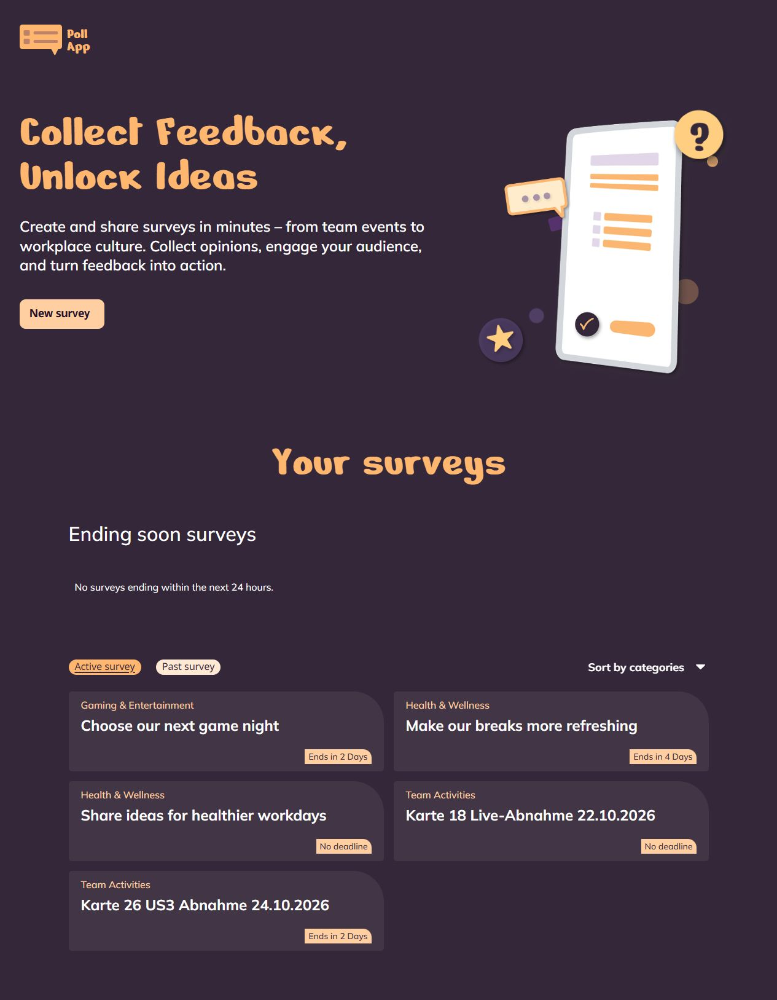

# Poll-App

Poll-App ist eine responsive Webanwendung zum Erstellen und Beantworten von Umfragen. Sie verbindet Angular mit Supabase: Umfragen werden dauerhaft gespeichert, nach Status und Kategorie gefiltert und ihre Ergebnisse in Echtzeit aktualisiert.

## Live Demo

[Poll-App live öffnen](https://andrewojak1618-debug.github.io/POLL-App/)

## Preview



Die Vorschau zeigt die lokal laufende Anwendung mit Supabase-Daten. Inhalte und Deadlines ändern sich mit den gespeicherten Umfragen.

## Inhaltsverzeichnis

- [Voraussetzungen](#voraussetzungen)
- [Tech Stack](#tech-stack)
- [Quickstart](#quickstart)
- [Supabase einrichten](#supabase-einrichten)
- [Bedienung](#bedienung)
- [Funktionen](#funktionen)
- [Projektstruktur](#projektstruktur)
- [Qualität prüfen](#qualität-prüfen)
- [Deployment](#deployment)
- [User Stories](#user-stories)
- [Bekannte Grenzen und Extras](#bekannte-grenzen-und-extras)
- [Design und Lernziele](#design-und-lernziele)

## Voraussetzungen

- Node.js **24.15.0**, passend zum GitHub-Actions-Workflow, sowie npm
- Git zum Klonen des Repositorys und ein eigenes Supabase-Projekt mit den unten aufgeführten Migrationen
- Internetzugriff für Supabase und die eingebundenen Google Fonts

Die im Projekt hinterlegte Paketmanager-Version ist npm 11.16.0. Mit `node --version` und `npm --version` lassen sich die lokal installierten Versionen prüfen. Eine globale Angular-CLI-Installation ist nicht nötig; die npm-Befehle verwenden die Projektversion.

## Tech Stack

| Technologie | Verwendung |
| --- | --- |
| Angular 22 und TypeScript | Standalone-Komponenten, Routing, Reactive Forms und Signals |
| HTML und SCSS | Semantische Struktur, responsive Gestaltung und Fokuszustände |
| Supabase Postgres | Kategorien, Umfragen, Fragen und Antwortoptionen |
| Supabase RPC und RLS | Validierte Schreibzugriffe und öffentliche Leserechte |
| Supabase Realtime und RxJS | Aktualisierung von Umfragen und Ergebnissen |
| Vitest und ESLint | Automatisierte Tests und Codeprüfung |

## Quickstart

```bash
git clone https://github.com/andrewojak1618-debug/POLL-App.git
cd POLL-App
npm ci
```

Supabase wie im nächsten Abschnitt vorbereiten und die öffentliche Konfiguration eintragen. Anschließend:

```bash
npm start
```

Der Entwicklungsserver öffnet die Anwendung unter `http://localhost:4200/`.

## Supabase einrichten

Im SQL Editor eines neuen Supabase-Projekts mit der Datenbankrolle `postgres` die Dateien aus `supabase/migrations` in dieser Reihenfolge ausführen:

1. `20261019000000_create_survey_tables.sql`
2. `20261019010000_allow_public_survey_reads.sql`
3. `20261019020000_create_survey_with_questions.sql`
4. `20261021000000_vote_for_question.sql`
5. `20261021010000_enable_survey_realtime.sql`

Die Realtime-Migration setzt die Supabase-Publication `supabase_realtime` voraus und nimmt die drei Tabellen für Umfragen, Fragen und Antwortoptionen auf. Bereits angewendete Migrationen nicht pauschal erneut ausführen. Danach `supabase/seed.sql` für die drei Kategorien und Beispielumfragen ausführen.

Der Seed enthält aktive, bald endende, vergangene und deadlinefreie Beispiele sowie unterschiedliche Stimmenzahlen. Wiederholtes Ausführen erzeugt keine Duplikate und erhält bestehende Stimmen und Deadlines. Relative Deadlines gelten ab der ersten Anlage; ältere Beispiele laufen deshalb mit der Zeit ab und werden durch erneutes Seeding nicht wieder geöffnet.

Die mitgelieferte Konfiguration verweist auf das Demo-Projekt. Für eine eigene Einrichtung vor dem lokalen Start in `src/environments/environment.ts` die Projekt-URL und den öffentlichen Publishable-Key des eigenen Supabase-Projekts eintragen:

```ts
supabase: {
  url: 'https://DEIN_PROJEKT.supabase.co',
  publishableKey: 'DEIN_OEFFENTLICHER_PUBLISHABLE_KEY',
}
```

Der Publishable-Key ist im Browser sichtbar. Auf den vier Umfragetabellen ist RLS aktiv; `anon` und `authenticated` dürfen lesen, aber nicht direkt schreiben. Neue Umfragen und Stimmen werden über `create_survey_with_questions` und `vote_for_question` validiert gespeichert.

Ein `service_role`- oder Secret-Key darf niemals im Frontend oder Repository hinterlegt werden.

## Bedienung

1. Auf Home zwischen **Active survey** und **Past survey** wechseln.
2. Kategorien für beide Listen unabhängig auswählen; **All Surveys** setzt den jeweiligen Filter zurück.
3. Über **New survey** das Formular öffnen, Titel und Kategorie wählen und Fragen mit mindestens zwei ausgefüllten Antworten anlegen. Beschreibung und Enddatum sind optional.
4. Pro Frage Einfach- oder Mehrfachauswahl festlegen. **Publish** speichert die Umfrage und zeigt eine Erfolgsbestätigung. Nach dem Schließen öffnet sich die neu erstellte Umfrage; **Cancel** verlässt die Ansicht ohne Speicherung.
5. Eine Umfrage öffnen und pro Frage Antworten auswählen. **Complete survey** prüft die Auswahl und speichert die Antworten pro Frage. Nach vollständigem Erfolg öffnet sich Home.
6. Ergebnisse erscheinen auf Desktop rechts neben der Abstimmung. Mobil lassen sie sich über **Show results** und **Close results** ein- und ausblenden.

Bei einem Speicherfehler bleibt die Auswahl erhalten. Ein erneuter Versuch überspringt in der aktuellen Detailansicht bereits erfolgreich gespeicherte Fragen.

## Funktionen

| Funktion | Verhalten |
| --- | --- |
| Active / Past | Ohne Deadline aktiv; ab Erreichen der Deadline vergangen |
| Ending soon | Aktive Umfragen mit Deadline innerhalb der nächsten 24 Stunden, frühestes Ende zuerst |
| Kategorien | Team Activities, Gaming & Entertainment, Health & Wellness |
| Dynamisches Formular | Mehrere Fragen und Antwortoptionen, Pflichtfeldprüfung einschließlich Leerzeichen |
| Optionale Deadline | Ende des gewählten Tages in Europe/Berlin einschließlich Sommer-/Winterzeit |
| Abstimmung | Radio-Buttons oder Checkboxen je Frage, gemeinsame Abgabe |
| Ergebnisse | Stimmen und gerundete Prozentwerte; bei null Stimmen 0 % |
| Live-Aktualisierung | Neue Umfragen und Stimmen werden über einen gemeinsam verwendeten Realtime-Kanal aktualisiert |
| Vergangene Umfragen | Inhalte und Ergebnisse bleiben lesbar; Antwortauswahl und Abgabe sind gesperrt |
| Bedienbarkeit | Tastaturfokus, verknüpfte Fehlermeldungen, Statusmeldungen und reduzierte Bewegung |

## Projektstruktur

```text
public/                  Logos, Icons und Illustrationen
src/app/home/            Übersicht, Kategorien und Highlights
src/app/create_survey/   Formular und Umwandlung der Eingaben
src/app/surveys/detail/  Abstimmung und Ergebnisanzeige
src/app/shared/          Datenzugriff, Store, Modelle und gemeinsame UI
src/environments/       Öffentliche Supabase-Konfiguration
src/styles/             Gemeinsame Gestaltung
supabase/migrations/    Tabellen, Rechte, RPCs und Realtime
supabase/seed.sql        Kategorien und Beispieldaten
docs/images/            README-Vorschau
```

## Qualität prüfen

```bash
npm run lint
npm test -- --watch=false
npm run build
```

Prüfstand vom 25.10.2026: 231 Tests in 36 Dateien erfolgreich, Linter ohne Fehler oder Warnungen. Der Produktionsbuild ist erfolgreich, meldet aber Größenwarnungen für das Initial-Bundle (603,87 kB bei 500 kB Warnbudget) und die Detail-Styles (7,87 kB bei 4 kB Warnbudget).

Für einen manuellen Realtime-Test dieselbe aktive Testumfrage in zwei getrennten Browserfenstern öffnen. Im ersten Fenster Antworten auswählen und über **Complete survey** speichern. Im zweiten Fenster müssen Stimmen, Prozentwerte und Balken ohne Neuladen aktualisiert werden. Dieser Test speichert echte Stimmen im verwendeten Supabase-Projekt.

## Deployment

Der Workflow `.github/workflows/github_pages.yml` baut und veröffentlicht die App nach einem Push auf `main` oder einem manuellen Start unter **Actions**. Vor dem Build müssen Linter und Tests erfolgreich sein.

1. Im GitHub-Repository **Settings → Pages → Build and deployment → Source → GitHub Actions** auswählen.
2. Änderungen auf `main` pushen oder den Workflow unter **Actions → Deploy Poll-App to GitHub Pages → Run workflow** für `main` starten.
3. Unter **Actions** den erfolgreichen Lauf prüfen; **Settings → Pages** zeigt anschließend die veröffentlichte Adresse.

Die App ist unter [https://andrewojak1618-debug.github.io/POLL-App/](https://andrewojak1618-debug.github.io/POLL-App/) veröffentlicht. Am 25.10.2026 wurden Home mit Supabase-Daten sowie direkte Aufrufe und Neuladen der Create-Survey- und Detailroute erfolgreich geprüft. Nach der Logo-Korrektur in Commit `323c904` waren Build und Deployment erfolgreich; der Home-Logo-Link wurde live auf das Ziel `/POLL-App/` geprüft. [Deployment-Nachweis](https://github.com/andrewojak1618-debug/POLL-App/actions/runs/40176653202).

Der Workflow verwendet Node.js 24.15.0 und `npm ci`. Der Produktionsbuild erhält `--base-href /POLL-App/`; veröffentlicht wird ausschließlich `dist/poll-app/browser`.

Für direkte Aufrufe und Neuladen von `/POLL-App/create-survey` und `/POLL-App/surveys/:id` wird die gebaute `index.html` als `404.html` mit ausgeliefert. GitHub Pages liefert bei unbekannten Dateipfaden diese App-Datei aus; Angular übernimmt die ursprüngliche Route. Assets werden durch die Basisadresse aus `/POLL-App/` geladen. Der HTTP-Status des ersten direkten Aufrufs bleibt dabei 404, obwohl die App im Browser die richtige Ansicht darstellt. Das ist ein Pages-Fallback, kein serverseitiger 200-Rewrite.

Der normale lokale Start und `npm run build` behalten die Basisadresse `/`. Die öffentliche Supabase-Konfiguration wird aus `src/environments/environment.ts` eingebunden; ein Secret- oder service_role-Key wird nicht benötigt.

## User Stories

| User Story | Umsetzung |
| --- | --- |
| 1 – Dringende Umfragen | Sortierte Highlights oberhalb der Liste |
| 2 – Übersicht | Home, Active/Past, Kategorie, Titel, Deadline und getrennte Filter |
| 3 – Erstellen | New survey, eigenes Formular, Pflichtfelder und Speicherung |
| 4 – Details | Fragen, Optionen, Zusatzinformationen, Live-Ergebnisse und lesbare Past Surveys |
| 5 – Teilnehmen | Antwortauswahl, Complete survey und gleichzeitige dynamische Auswertung |

## Bekannte Grenzen und Extras

- Keine Anmeldung. Abgeschlossene Teilnahme wird in diesem Browser gespeichert; andere Geräte oder gelöschte Browserdaten können diesen Komfortschutz umgehen.
- Antworten werden pro Frage gespeichert. Die gesamte Abgabe mehrerer Fragen ist keine gemeinsame Datenbanktransaktion.
- Das Überspringen bereits gespeicherter Fragen beim erneuten Versuch gilt innerhalb der aktuellen Detailansicht; es ist keine dauerhafte Wiederholungssperre nach Neuladen.
- **New survey** öffnet unter `/#/create-survey` einen modalen Dialog über Home. Escape und Cancel führen zurück; der Hintergrund ist währenddessen nicht bedienbar.
- Antwortklicks zeigen eine ausdrücklich gekennzeichnete lokale Ergebnisvorschau. **Complete survey** speichert; erst bestätigte Stimmen zählen für andere Sitzungen. Die Erfolgsbestätigung bleibt acht Sekunden sichtbar.

### Ergänzungen zum ursprünglichen Checklistenwortlaut

Mehrere Fragen pro Umfrage und Mehrfachauswahl je Frage gehören zum vereinbarten Figma-Umfang. Die animierte Home-Illustration mit Unterstützung für `prefers-reduced-motion` ergänzt die Gestaltung. Weitere Extras werden hier nur ergänzt, wenn sie tatsächlich umgesetzt und vereinbart sind.

## Design und Lernziele

Die Gestaltung folgt dem [Figma-Design Poll-App](https://www.figma.com/design/yjKdGp9Z612bnRp2iayYe7/Poll-App-Design). Logos, Illustrationen und Icons sind als Projektdateien eingebunden. Die verwendeten Schriften sind Nerko One, Mulish und Nokora.

Das Projekt vertieft Angular-Routing, Reactive Forms, Signals, getrennte Verantwortlichkeiten von Repository und Store, Supabase-Rechte, Realtime sowie responsive und zugängliche Bedienung.

## Review-Abnahme vom 26.10.2026

- Neue Umfragen ohne gewähltes Enddatum enden nach 24 Stunden. Bestehende Umfragen werden nicht rückwirkend verändert.
- Alle sechs Figma-Kategorien sind in Migration und Seed enthalten.
- Publish bleibt bei ungültigen Eingaben bedienbar, damit konkrete Feldmeldungen erscheinen. Während Laden oder Speichern ist die Aktion gesperrt.
- Textmeldungen reservieren ihren Platz; ein ungültiges Formular fokussiert die erste notwendige Eingabe.
- Gefüllte Antworten werden erst geleert, leere zusätzliche Antworten beim nächsten Klick entfernt.
